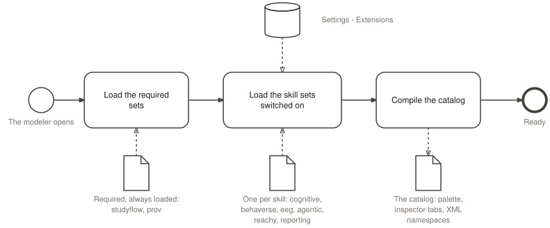
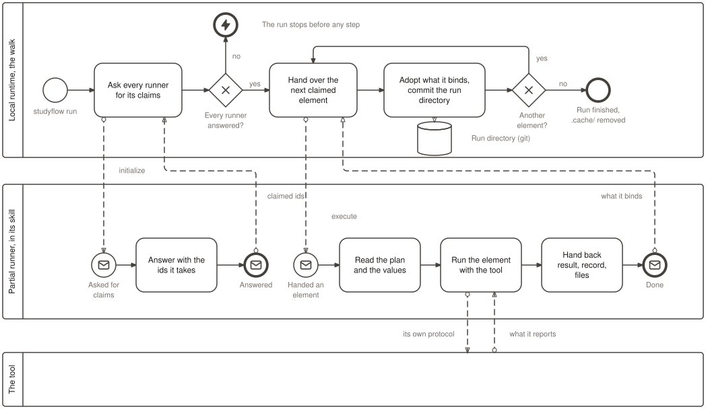

The [repository](https://github.com/behaverse/studyflow-modeler) says how to build, test and contribute. This page shows how a tool joins Studyflow.

## Skills {#skills}

A tool joins through a *skill*: one folder that gives authors a domain's elements, and runs them. Any part may be missing.

| Part | File | Gives |
|:--|:--|:--|
| manifest | `SKILL.md` | its name, what it is for, and which parts it has |
| vocabulary | `*.moddle.yaml` | element types, their attributes, palette templates |
| runners | `local.py`, `browser/` | what executes its elements in each runtime |
| modeler module | `modeler.ts` | exports, imports, inspector sections, settings pages, examples the New dialog leads with |
| examples, tests | `examples/`, `tests/` | studies that use it, and its checks |

{#fig-schema-map fig-alt="A Studyflow diagram. When the modeler opens, it loads the required sets, studyflow and prov; then the skill sets switched on in Settings, Extensions, one per skill: cognitive, behaverse, eeg, agentic, reachy and reporting; then compiles the catalog, which gives the palette, the inspector tabs and the XML namespaces."}

### Declare a type

A type extends a BPMN element, so a file that uses it stays valid BPMN.

```yaml
name: My lab
prefix: mylab
uri: http://example.org/schemas/mylab
types:
  - name: Calibration
    description: Calibrates the eye tracker before a block.
    superClass:
      - bpmn:Task
    meta:
      icon: iconify tabler--focus-2
    properties:
      - name: points
        description: How many points the calibration shows.
        isAttr: true
        type: Integer
        meta:
          showInline: true
```

[`skills/SCHEMAS.md`](https://github.com/behaverse/studyflow-modeler/blob/main/skills/SCHEMAS.md) is the reference for the format. Often no type is needed: a tool's step can be a plain service task with an `implementation`.

## Runners {#runners}

In a local run, the walk hands each step to the *runner* that claims it. A runner in Python is two functions:

```python
import os, sys
from pathlib import Path
sys.path.insert(0, os.environ.get("STUDYFLOW_LOCAL") or str(Path(__file__).resolve().parents[2] / "packages" / "runtime-local" / "python"))
from runner import serve

def claims(plan):            # the ids of the elements this runner takes
    return [eid for eid, e in plan["elements"].items()
            if e["attributes"].get("implementation", "").startswith("echo://")]

def execute(step):           # one hand-off; what it returns is the step's result
    return step.fill(step.element["additionalArguments"] or "")

if __name__ == "__main__":
    sys.exit(serve(claims, execute))
```

Try it on one run, without installing anything:

```bash
studyflow run study.studyflow.yaml --runner echo="uv run --script ./local.py" --debug
```

{#fig-runner-contract fig-alt="A Studyflow collaboration diagram in three pools. The top pool, the local runtime, starts a run and asks every runner for its claims; if a runner does not answer, the run stops before any step. Otherwise it hands over the next claimed element, adopts what it hands back and commits the run directory, repeats while elements remain, removes .cache/ and finishes. The middle pool, the partial runner in its skill, answers initialize with the ids it takes, and on execute reads the plan and the run's values, runs the element with its tool, and hands back its result, record and files. Dashed message flows join the two pools. The bottom pool is the tool, reached only through its own protocol."}

[`CONTRACT.md`](https://github.com/behaverse/studyflow-modeler/blob/main/packages/runtime-local/CONTRACT.md) is the contract. The [`python`](https://github.com/behaverse/studyflow-modeler/tree/main/skills/python) and [`shell`](https://github.com/behaverse/studyflow-modeler/tree/main/skills/shell) skills are short working runners.
