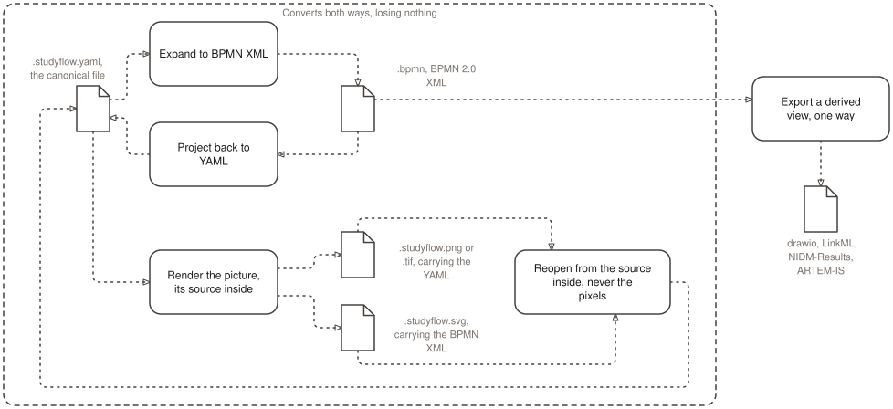

## Files

{#fig-round-trip fig-alt="A Studyflow diagram of files and conversions. Inside a dashed group labelled converts both ways, losing nothing: .studyflow.yaml, the canonical file, expands to .bpmn BPMN 2.0 XML, which projects back to YAML; rendering the picture writes .studyflow.png or .studyflow.tif, carrying the YAML, and .studyflow.svg, carrying the BPMN XML; and reopening from the source inside, never the pixels, gives the YAML back. Outside the group, exporting a derived view writes .drawio, LinkML, NIDM-Results and ARTEM-IS, one way."}

| File | Is |
|:--|:--|
| `.studyflow.yaml` | the study, in its canonical form |
| `.bpmn`, `.xml` | the same study as BPMN 2.0 XML |
| `.studyflow.png` | a picture with the study's YAML inside |
| `.studyflow.svg` | a picture with the study's BPMN XML in its metadata |
| `.studyflow.tif` | the TIFF a journal asks for, the YAML inside |
| `.drawio`, `.linkml.yaml`, `.nidm.ttl`, `.artemis.json`, a jsPsych timeline `.json` | one-way exports, for the tools that read them |

The first five convert into one another without loss ([`studyflow convert`](cli.qmd#convert)). An image that has been through a screenshot tool or a vector editor loses the study, so keep the `.studyflow.yaml` too.

## A complete study

```yaml
schemas:
  cognitive: http://behaverse.org/schemas/studyflow/cognitive
  studyflow: http://behaverse.org/schemas/studyflow/v1

Minimal_Study:
  type: Process
  name: Minimal study
  extensions:
    studyflow:Study: {}
  elements:
    Enrolled:
      type: StartEvent
      name: Enrolled and consented
      consentFormUri: https://example.org/consent.md

    Flanker:
      type: Task
      name: Flanker
      extensions:
        cognitive:CognitiveTask:
          platform: jspsych
          implementation: https://github.com/jspsych/jspsych-contrib@v0.4.0#flanker

    Done:
      type: EndEvent
      name: Done
      redirectTo: https://app.prolific.com/submissions/complete?cc={COMPLETION_CODE}
      completionCodeType: dynamic

    # the edges
    Flow_Enrolled_Flanker:
      source: $Enrolled
      target: $Flanker

    Flow_Flanker_Done:
      source: $Flanker
      target: $Done
```

It holds no geometry. The modeler lays it out on opening, and saves the geometry under `layout` once you rearrange things ([The drawing](#the-drawing)).

## The document {#the-document}

The top level is BPMN's `definitions`:

[TODO: combine definitions and schemas into one, follow BPMN XML naming for extra schemas]
[TODO: use BPMN bpmndi:BPMNDiagram for the layout, e.g., diagram instead of layout; also use the term diagram for the view that shows the drawing]

| Key | Holds |
|:--|:--|
| `schemas` | the namespaces the file uses besides BPMN's, prefix to URI; the core's URI carries the format version |
| `definitions` | the document's other attributes, such as `targetNamespace` |
| one key per root element | each process, collaboration, data store and message, by its id |
| `layout` | the drawing ([The drawing](#the-drawing)) |
| `state` | what the last run left ([What a run adds](#what-a-run-adds)) |

## Elements and their keys {#elements-and-their-keys}

An element sits where BPMN nests it, keyed by its id. Its `type` is its BPMN type without the `bpmn:` prefix (`Task`, `StartEvent`). Its keys are BPMN's property names, shortened by three rules:

| Rule | Gives |
|:--|:--|
| a reference drops `Ref` | `source`, `target`, `attachedTo` |
| a true-or-false drops `is` | `executable`, `interrupting` |
| a key drops what its element already says | a loop's `maximum`, a pool's `multiplicity` |

A timer keeps `timeDuration`, `timeDate` and `timeCycle`, since `duration` means a step's planned length.

[TODO: use duration, progress, and onset for all elements including events and task as a super class that both can extend, replace timeCycle, timeDate, etc in events]

A few keys are named for what they hold in a study:

[TODO: simplify the nodes, as it may be better to call it flowNode or just elements like the root study]

| In Studyflow | In BPMN |
|:--|:--|
| `elements` | `flowElements` |
| `inputs`, `outputs` | `dataInputAssociations`, `dataOutputAssociations` |
| `extensions` | `extensionElements` |
| `condition` | a flow's `conditionExpression` |
| `nodes` | a lane's `flowNodeRef` |
| `item` | `itemRef`, `itemSubjectRef` |

Defaults are left out. [`names.ts`](https://github.com/behaverse/studyflow-modeler/blob/main/packages/core/src/model/names.ts) holds every key.

| Written | Is |
|:--|:--|
| `$Exit` | a reference to an element in this file |
| `{max_unanswered}` inside text | a [placeholder](reference.qmd#placeholders) |
| a value under `condition`, `while` or `transformation` | an [expression](reference.qmd#expressions) |

### Extensions

What Studyflow and its skills add is an extension, as in the XML. An element keeps its BPMN type, and its extension entries sit under `extensions`, each under its prefixed type:

```yaml
    S1_FF_Flanker:
      type: ChoreographyTask
      name: Flanker task
      participant: $Pool_Agent
      extensions:
        cognitive:CognitiveTask:
          platform: jspsych
          implementation: jspsych://html-keyboard-response@8
```

- The study is the `studyflow:Study` entry of its root.
- A core attribute is written bare on its element (`onset`, `consentFormUri`).
- Anything the reader does not recognize is kept, written back, and reported.

## Edges {#edges}

An edge needs no `type`: where it sits and its ends say what it is.

```yaml
    Flow_Enrolled_Flanker:
      source: $Enrolled
      target: $Flanker

    Again:
      name: again
      source: $Gate
      target: $Say
      condition: state._meta.reached.Gate < 8
```

A data edge sits on its activity and names only its data: an input its `source`, an output its `target`. An input may say which argument it fills (`parameter: X`), and a `transformation` narrows the value.

[TODO: use incoming and outgoing terms]

```yaml
    Play:
      type: Task
      name: WhichOne, 5 Simon trials
      inputs:
        In_Play_Parameters:
          source: $Play_Parameters

      outputs:
        Out_Unanswered:
          target: $P_Unanswered
          transformation: result.missed / result.trials
```

## Events and loops {#events-and-loops}

An event names what triggers it under a key of that kind: `timer`, `message`, `condition`, `error`. A loop marker sits under `loopCharacteristics`.

```yaml
    Wait:
      type: IntermediateCatchEvent
      name: 3 weeks
      timer: P21D

    Exit_S1:
      type: BoundaryEvent
      attachedTo: $S1
      condition: unanswered > max_unanswered

    Retry:
      type: Task
      name: Retry until good
      loopCharacteristics:
        while: score < 0.9
        maximum: 5
```

## What a run adds {#what-a-run-adds}

A run adds two things and changes nothing else: its records, as `prov:Activity` entries on the elements they are about, and the `state` it left, at the end of the file.

```yaml
Drawn_Loop:
  type: Process
  extensions:
    studyflow:Study: {}
    prov:Activity:
      - {action: created, when: "2026-07-30T22:24:02Z", with: studyflow-modeler/26.0615}
      - {action: executed, when: "2026-10-22T11:26:43+02:00", with: studyflow-cli/26.10.13, run: repo, plan: "sha256:ddb256bd…"}
  elements:
    Gate:
      type: ExclusiveGateway
      default: $Exit
      extensions:
        prov:Activity:
          - {action: executed, when: "2026-10-22T11:26:44+02:00", what: Exit, run: repo, commit: c1e5d863…}

state:
  _meta:
    reached:
      Say: 8
      Gate: 8
      Exit: 1
```

[Reference](reference.qmd#records-of-a-run) explains each field.

## The drawing {#the-drawing}

The drawing is one `layout` map at the end of the file, a line per element. An edit to the protocol and an edit to its drawing are then diffs of different parts of the file.

```yaml
layout:
  Enrolled: {bounds: 160 180 36 36, label: 146 223 66 30}
  Flanker: 250 158 120 80
  Flow_Enrolled_Flanker: 196,198 250,198
```

A shape's line is its box, `x y width height`. An edge's is its route, `x,y x,y …`. A line that says more is a mapping (`bounds`, `label`, `fill`).

## Shorthands {#shorthands}

The tools also read forms you may type by hand, such as `Flow_1: Enrolled -> Flanker` for an edge, or BPMN's own keys (`sourceRef`, `flowElements`). [`spelling.ts`](https://github.com/behaverse/studyflow-modeler/blob/main/packages/core/src/model/spelling.ts) holds every one.
