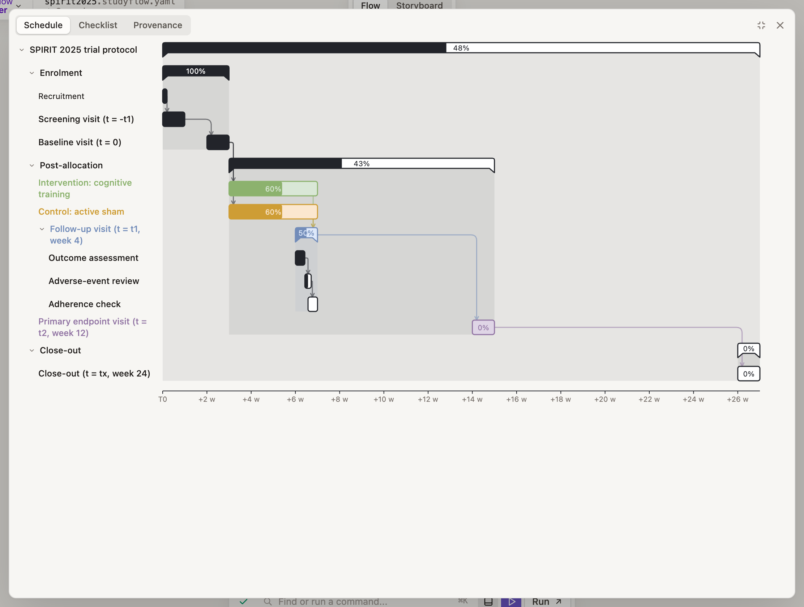
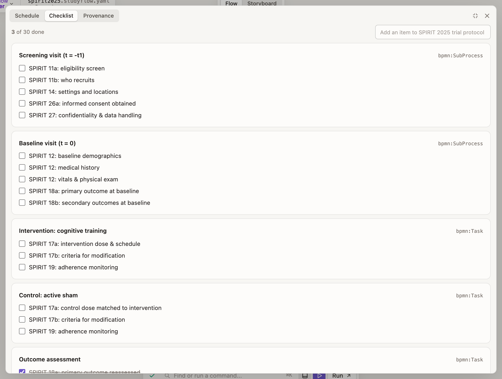
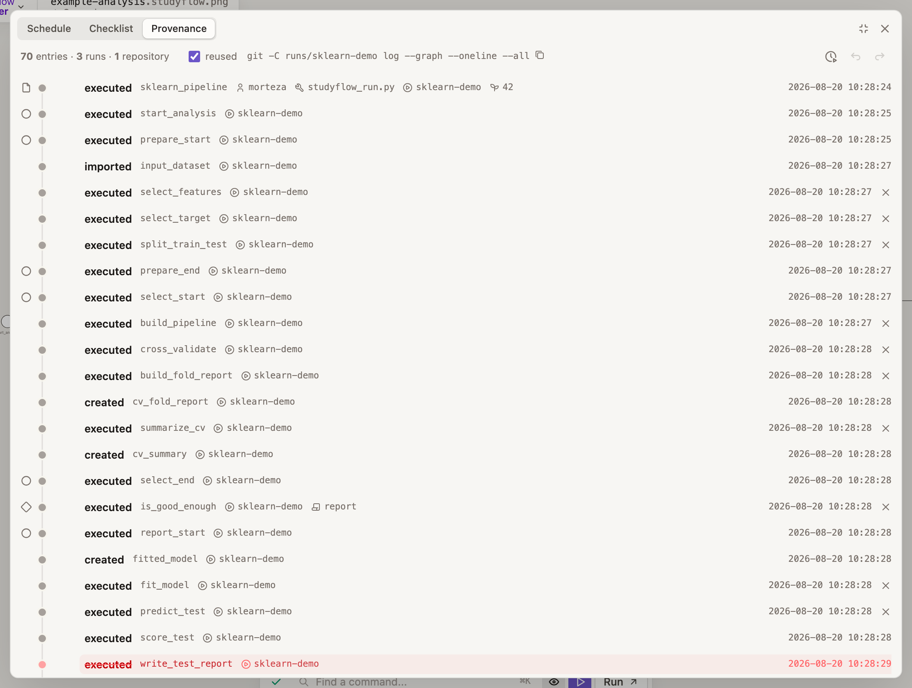

Studyflow is a graphical notation for describing and coordinating experiments: AI evaluations, behavioral and cognitive research, clinical studies. A study is one file, and often just an image. You can open it in a browser, edit it, run it, or produce a protocol document from it. While your code computes, Studyflow coordinates it[^gelernter].

That one file is the protocol, the plan that runs, the record of what ran, and the figure for the paper.

A studyflow diagram is valid [BPMN 2.0](https://www.omg.org/spec/BPMN/2.0/), so other BPMN tools open it.

 to edit or run it.](assets/img/example-experiment.studyflow.svg)

The same notation describes an analysis, from raw data to final figures, and runs it locally, on a cluster, or in the cloud:

, or run it with `studyflow run`.](assets/img/example-analysis.studyflow.png)

## Why

Today an experiment is described many times: a protocol for the ethics approval, a preregistration form, a script for the data collection, a notebook for the analysis, a figure for the manuscript. Each copy is maintained separately and nothing checks them against each other, so they drift apart. We are no longer surprised when the preregistration says four conditions, the script implements five, the analysis uses three, and the figure shows two.

Replications usually stop on this gap between what was described and what ran[^hardwicke] [^variability].

A studyflow diagram replaces these copies with one file. Each document you need is a *view* of it.

## How it works

1. **Draw** the study in the [modeler](tutorial.qmd), with BPMN's elements and those a domain adds.
2. **Save** it as YAML, or as an image that carries it.
3. **Run** it in a browser or on your machine. The [run](reference.qmd#running) is [recorded](reference.qmd#records-of-a-run) in the file itself.
4. **View** it as a schedule, a checklist, a provenance log, a reporting diagram, or a figure.

::: {layout-ncol=3}
{#figs-timeline fig-alt="The Schedule view: rows grouped under Enrolment, Post-allocation and Close-out, each a bar on one time axis in weeks, with arrows from a step to the step it waits on."}

{#figs-checklist fig-alt="The Checklist view reading 3 of 30 done, with one card per element listing its SPIRIT reporting items as checkboxes."}

{#figs-provenance fig-alt="The Provenance view listing the records of three runs, each row an action, an element, a tool and a timestamp."}
:::

To try it, [open the modeler](https://behaverse.org/studyflow-modeler/app) and choose New, or install the [command line](cli.qmd).

[^gelernter]: Gelernter, D., & Carriero, N. (1992). Coordination languages and their significance. *Communications of the ACM*, 35(2), 97-107.

[^hardwicke]: Hardwicke, T. E., et al. (2018). Data availability, reusability, and analytic reproducibility. *Royal Society Open Science*, 5(8), 180448.

[^variability]: Botvinik-Nezer, R., et al. (2020). Variability in the analysis of a single neuroimaging dataset by many teams. *Nature*, 582, 84-88.
