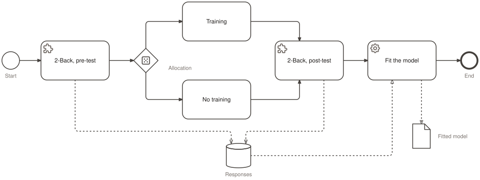
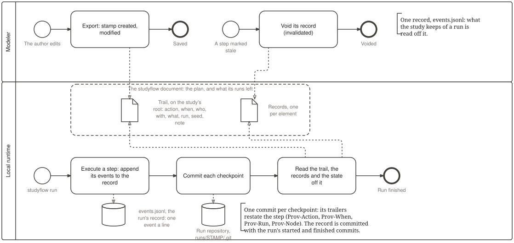

# Notation

## Two graphs in one file

A study is a graph of events, tasks, gateways and data. Two kinds of edge join them:

- **Sequence flows** (solid arrows) say what happens after what.
- **Data associations** (dotted arrows) say what a step reads and writes.

{#fig-two-graphs fig-alt="A left-to-right Studyflow diagram. Solid arrows walk from start through a 2-Back pre-test, a random allocation gateway splitting into training and no training, a 2-Back post-test, and a model-fitting step to end. Dotted arrows carry data beside that walk: the pre-test and post-test write into a responses store, which feeds the model-fitting step, which writes a fitted model."}

## Run state {#run-state}

A study keeps values while it runs. Where a value is declared decides how long it lives:

| Declared as | Lives for |
|:--|:--|
| a `DataStore` | the whole study, and from one run to the next |
| a property of a process | one participant |
| a property of a sub-process or a task | one pass through it |

A step writes a value through a data edge. Conditions and placeholders read it by name.

## Placeholders {#placeholders}

Text may cite a value as `{name}`, or a field of it as `{name.field}`. The name is looked up in this order:

1. `state`, from its root: `{state._meta.reached.Gate}`.
2. A property, in the nearest scope from the element outward: `{count}`.
3. A data store, by its name: `{excluded}`.
4. An element, by its id or a name no other element has, for the value it produced in this run: `{Play.trials}`.
5. `{reached}` alone: how often the run reached the element that cites it.

A placeholder that finds nothing stays as written.

## Expressions {#expressions}

Conditions and transformations are [FEEL](https://www.omg.org/dmn/), the expression language of the DMN standard: `accuracy >= 0.8`, `result.missed / result.trials`.

- An expression reads names by the placeholder rule.
- A condition holds only when it evaluates to `true`.
- Strings are double-quoted, and equality is `=`.

`studyflow validate` reports an expression the runtimes cannot run.

# Running a study {#running}

A run walks the study from its start event to an end event. Two runtimes host the same walk, so a study means the same in both.

{#fig-lifecycle fig-alt="A Studyflow diagram. The author saves the study, it is validated, and a gateway asks which runtime. On browser, the participant's steps run in the page, optionally posting sessions and events to a data server, until the session is over. On local, the plan is archived into runs/STAMP/, and the steps are walked, each checkpoint committed into the run repository, until the run finishes. A second start, running again after an edit, asks whether a record was invalidated: if so, the repository branches at that step's parent before the walk; if not, the walk resumes in place. A note says a later run skips each step whose record still stands."}

| | Browser | Local |
|:--|:--|:--|
| Runs | in a web page, at `/run/?diagram=<address>` | on your machine, with [`studyflow run`](cli.qmd#run) |
| For | one participant at a screen | an analysis, models or simulated participants, a device |
| A step is | a screen | a hand-off to the [runner](developers.qmd#runners) that claims it |
| Leaves | the record, to download | a [run repository](#records-of-a-run) |

The study's `runtime` attribute picks one, `local` unless set.

## How a gateway decides

| Gateway | Takes |
|:--|:--|
| exclusive | the first flow whose condition holds, else the default flow |
| parallel | every flow; as a join, it waits for all of them |
| inclusive | every flow whose condition holds, else the default flow |
| event-based | the branch whose event comes first: a message, a timer, or a condition |
| [random](https://github.com/behaverse/studyflow-modeler/blob/main/skills/cognitive/SKILL.md#allocation) | one flow, by a seeded draw |

With a `seed` on the study, every draw replays.

## Re-runs {#re-runs}

Run a study again in its repository, and it skips each step whose record still stands and whose inputs and outputs are unchanged. Editing a step, a condition or an input file re-runs that step and what depends on it.

## BPMN {#bpmn-conformance}

A study is valid BPMN 2.0, and a run follows BPMN's execution semantics. [`WALK.md`](https://github.com/behaverse/studyflow-modeler/blob/main/packages/runtime-local/WALK.md) lists the few places where a run reads a construct otherwise.

# Records of a run {#records-of-a-run}

Before it runs, a study is a plan. As it runs, what happened is added to the same file. "Did the study deviate from its plan?" is then a diff of one file against an earlier version of itself.

{#fig-provenance-model fig-alt="A Studyflow diagram in two lanes. In the Modeler lane, exporting a study stamps created and modified into the trail, and marking a step stale voids its record. In the Local runtime lane, executing a step appends its events to the record, events.jsonl, each checkpoint is committed into the run repository, runs/STAMP/.git, and when the run ends the trail, the records and the state are read off the record. A dashed group, the studyflow document, holds the trail on the study's root, whose entries carry action, when, who, with, what, run, seed and note, and the records, one per element. A note says each commit's trailers restate the step and the record is committed with the run's started and finished commits; another says there is one record, events.jsonl, and what the study keeps of a run is read off it."}

| A local run leaves | Where |
|:--|:--|
| the record | `events.jsonl`: every event, one JSON object a line, never rewritten |
| the executed copy | the study file, with its records and its state added ([File format](format.qmd#what-a-run-adds)) |
| the run repository | `.git`: a commit per step, holding what the step ran with and made |
| the log | `studyflow.log`: what the runners printed |

## State

The state is one tree under `state`, keyed by element id:

| Key | Holds |
|:--|:--|
| `state.<scope id>` | the properties that scope declares |
| `state.<store id>` | a data store's value |
| `state._meta.reached.<id>` | how often the run reached an element or took a flow |
| `state._meta.instance.<id>` | which pass a repeating activity is on |
