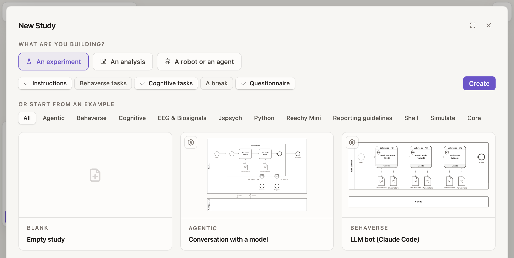
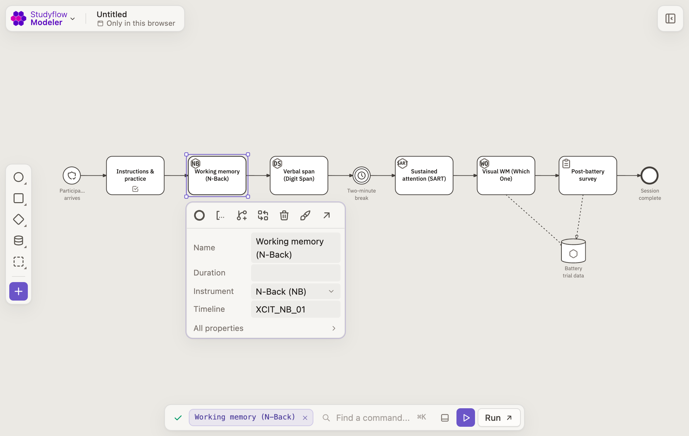
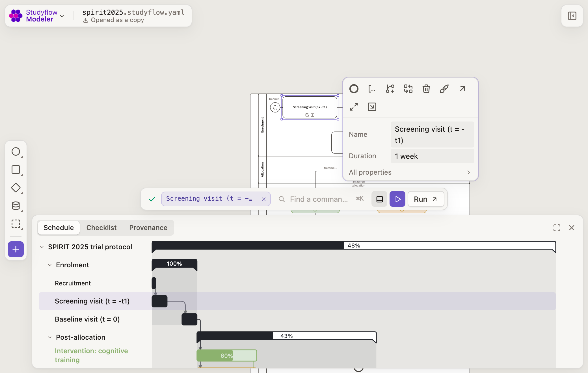

## 1. Open the modeler

[Open the modeler](https://behaverse.org/studyflow-modeler/app). It runs in the browser, offline, with no account. With the [command line](cli.qmd#install) installed, `studyflow ui` opens it from your machine.

## 2. Start a study

Choose **New** from the menu on the logo. Say what you are building, tick its parts, and press **Create**. Or pick an example.

{fig-alt="The New Study dialog. Under What are you building, An experiment is picked, and the parts Instructions, Cognitive tasks and Questionnaire are ticked beside a Create button. Example studies follow below."}

## 3. Shape it

| Do | Get |
|:--|:--|
| press the **+** on an arrow | a step on that arrow |
| press **+** in the tools, or double-click the canvas | the Add panel: every element and template |
| select a step | its actions, and its main fields to fill in |
| double-click a step | its name, to edit |

{fig-alt="The modeler window. A study of seven steps runs left to right across the canvas. One task is selected: under it a small panel shows a row of action icons and four fields, Name, Duration, Instrument and Timeline. The app menu and file name are top left, the tools down the left edge, and a command bar at the bottom."}

## 4. Check it

The bar at the bottom shows a check when the study can run, or a count of what is wrong. From a terminal:

```bash
studyflow validate study.studyflow.yaml
```

## 5. Run it

| Press or type | Runs |
|:--|:--|
| **▶** | a simulation on the canvas |
| **Run** | the study in the browser, a screen per step |
| `studyflow run study.studyflow.yaml` | the study on your machine, recording each step |

## 6. Read what ran

The views button in the bar opens a drawer under the canvas: the **Schedule**, the **Checklist**, and the **Provenance** of each run.

{fig-alt="The modeler with a drawer under the canvas. Its tabs read Schedule, Checklist and Provenance. The Schedule is open: a chart of bars on a time axis, one row highlighted. The same step is selected on the canvas above."}

## 7. Save it

| File | Is |
|:--|:--|
| `.studyflow.yaml` | the study as text, for git and for editing by hand |
| `.studyflow.png`, `.studyflow.svg` | a picture that carries the study and opens again in the modeler |
| `.bpmn` | BPMN 2.0 XML, for other BPMN tools |

⌘K finds any command. On Windows and Linux, Ctrl stands for ⌘.
